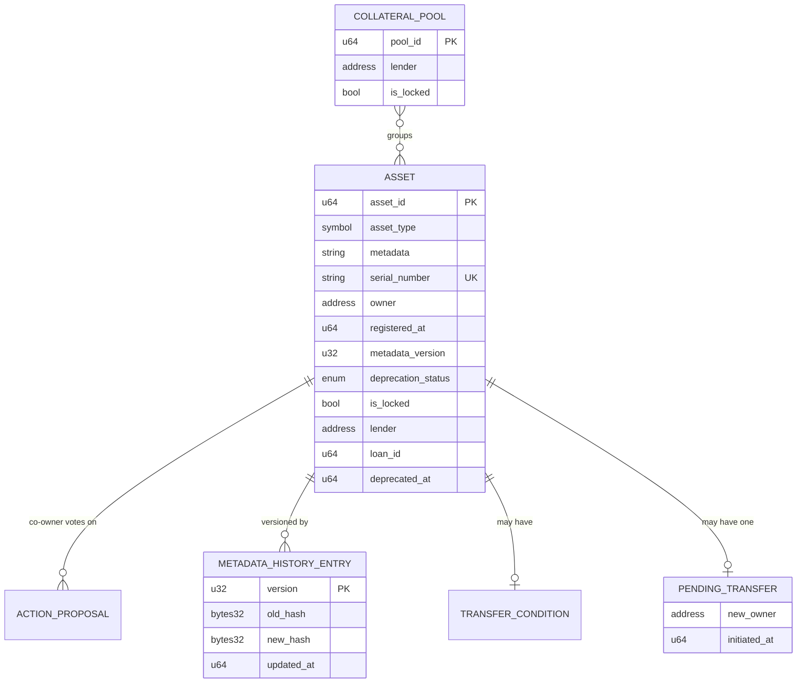
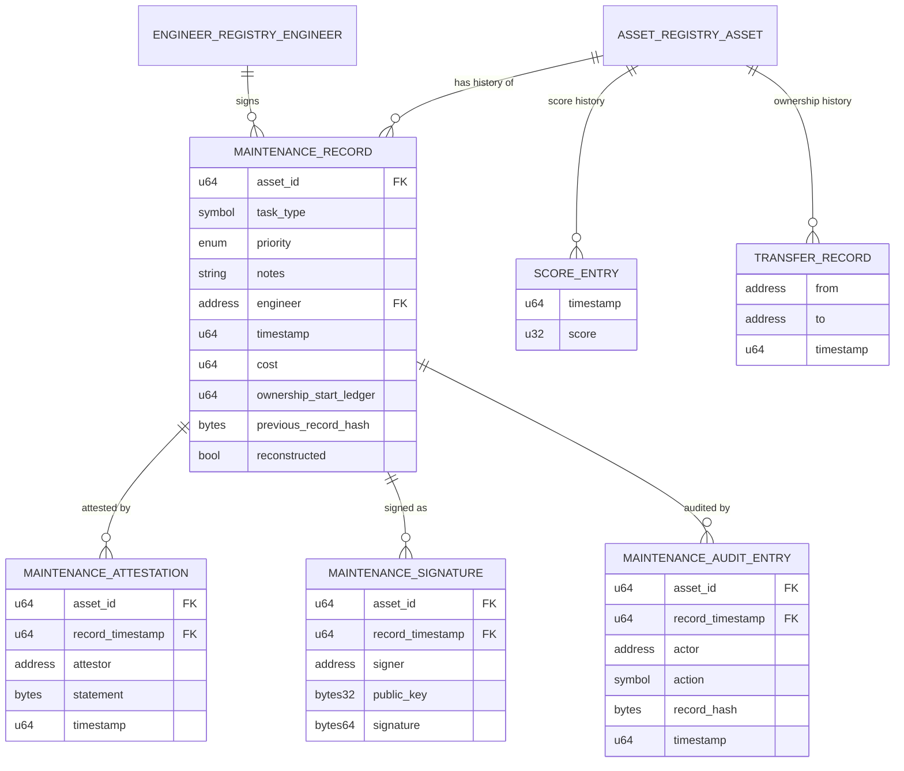
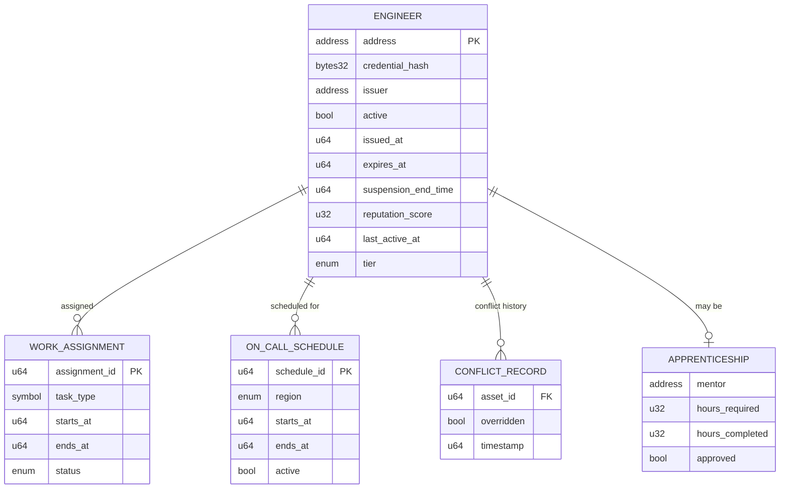
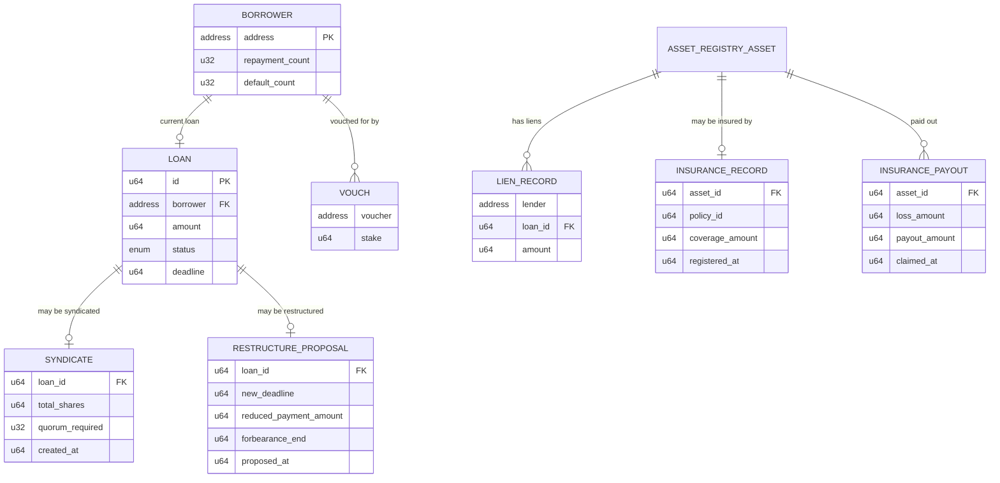
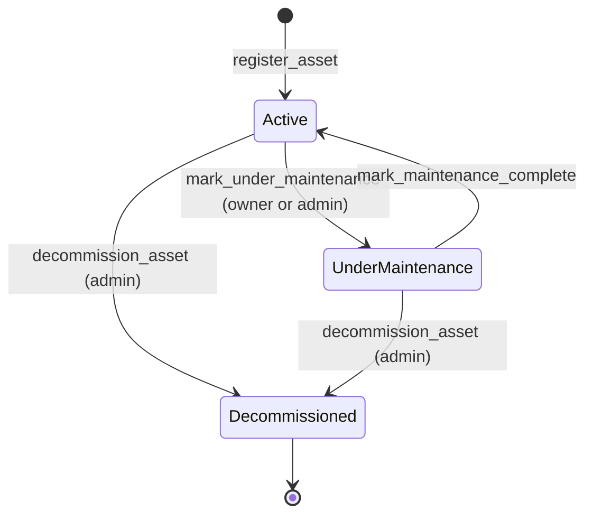
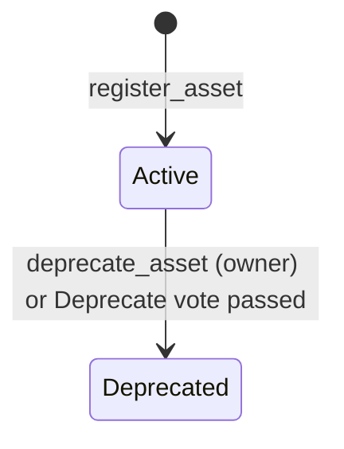
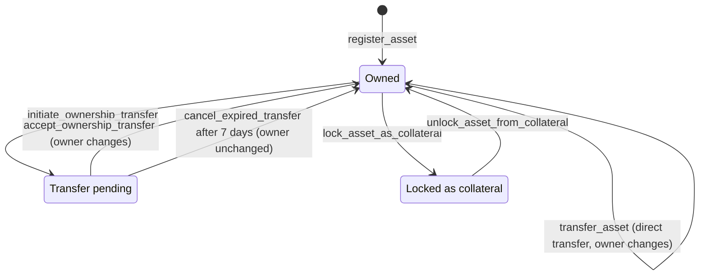
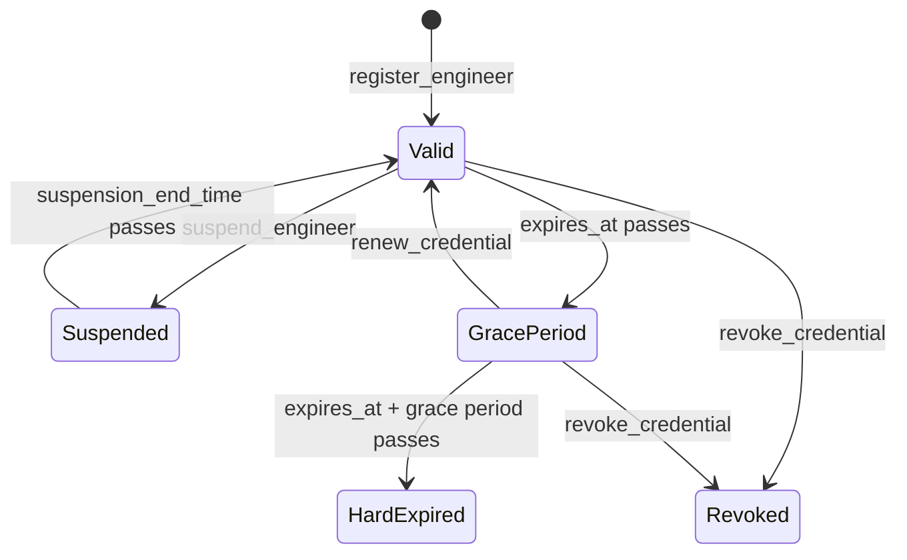
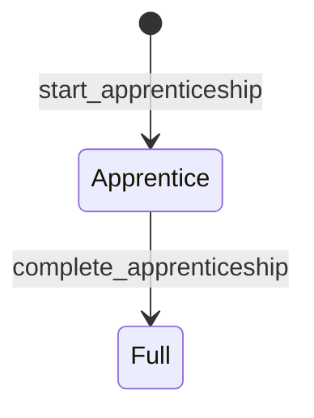
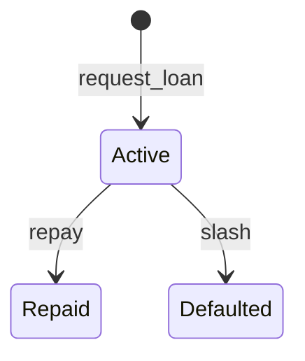

# Data Model

Last updated: October 16, 2026

This document describes the on-chain data model of the Mainstay contracts:
the entities, how they relate, how their states change, how values are
encoded, and what each field means. It is the reference for integrators
reading contract state and for operators debugging a record.

The source of truth is the Rust definitions in `contracts/*/src/`. Where this
document and the source disagree, the source wins. Please open an issue or a
PR to correct the document.

Contents:

1. [Contracts and ownership of data](#1-contracts-and-ownership-of-data)
2. [Entity relationships](#2-entity-relationships)
3. [State transitions](#3-state-transitions)
4. [Encoding conventions](#4-encoding-conventions)
5. [Examples](#5-examples)
6. [Data dictionary](#6-data-dictionary)
7. [Storage keys](#7-storage-keys)
8. [Known gaps](#8-known-gaps)

## 1. Contracts and ownership of data

Each entity is owned by exactly one contract. Other contracts refer to it by
ID or address and read it through a cross-contract call. They do not copy it.

| Contract | Owns | Refers to |
|---|---|---|
| `asset-registry` | `Asset`, co-owner voting, collateral pools, transfer state, bundle registrations | Lifecycle (for score-sorted search) |
| `engineer-registry` | `Engineer`, credentials, specializations, on-call, assignments, apprenticeships, conflicts | none |
| `lifecycle` | `MaintenanceRecord` and its attestations, signatures, audit trail, scores, transfer history, config | `AssetRegistry` (asset existence and status), `EngineerRegistry` (credential, reputation) |
| `lending` | `Loan`, `Vouch`, liens, syndicates, restructures, insurance | `AssetRegistry` (lock/unlock), `Lifecycle` (score), token contract |

The Lifecycle contract is the only contract that initiates cross-contract calls
for maintenance writes. See [architecture.md](architecture.md#cross-contract-call-flow).

## 2. Entity relationships

### 2.1 Asset registry



Co-owners are stored inside `ASSET` as `Vec<(Address, u32)>`. Each entry is an
address and its vote weight. They are not a separate entity.

### 2.2 Lifecycle (maintenance)



A maintenance record is identified by its `(asset_id, timestamp)` pair. Attestations,
signatures, and audit entries refer to a record by that pair as `record_timestamp`.

### 2.3 Engineer registry



### 2.4 Lending



`BORROWER` is shown as an entity because lending data is keyed by borrower
address. It is not a separate contract type.

### 2.5 Cross-contract references

These fields link records across contracts. They are plain IDs or addresses.
The receiving contract checks them on write.

| Field | Points to | Checked by |
|---|---|---|
| `MaintenanceRecord.asset_id` | `Asset.asset_id` (AssetRegistry) | `submit_maintenance` calls `get_asset` |
| `MaintenanceRecord.engineer` | `Engineer.address` (EngineerRegistry) | `get_credential_status`, then `verify_engineer` as fallback |
| `Asset.lender` / `Asset.loan_id` | `Loan.id` and the lending contract | `lock_asset_as_collateral` and `unlock_asset_from_collateral` |
| `LienRecord.loan_id` | `Loan.id` | `record_lien` and `release_lien` |
| `SearchFilter.lifecycle_contract` | Lifecycle contract address | Required for `ByCollateralScore` sorts |

## 3. State transitions

### 3.1 Asset availability

`AssetStatus` is not stored as one field. The registry derives it on read
(`asset_status`) from two flags. A decommissioned asset stays decommissioned
even if its maintenance flag is set.



`DeprecationStatus` is a separate, owner-controlled field on the asset:



`DeprecationStatus::Decommissioned` is defined in the enum, but no code path in
the asset registry assigns it. Decommissioning is recorded by the separate
decommission flag described above.

### 3.2 Ownership transfer and collateral lock



A locked asset cannot be transferred. The `is_locked` field documents this
rule. Transfer timeouts use `TRANSFER_TIMEOUT_SECS`, which is seven days.

### 3.3 Engineer credential

`CredentialStatus` is derived from the engineer record and the current ledger
time when `get_credential_status` is called. The grace period comes from
config and defaults to seven days.



`HardExpired` is terminal for the credential. `renew_credential` rejects it with
`CredentialExpired`, and it rejects revoked credentials with `CredentialRevoked`.

`CredentialStatus::Expired` is defined in the enum, but `get_credential_status`
does not return it. Treat `HardExpired` as the expired state.

### 3.4 Engineer tier



### 3.5 Loan



`LoanStatus::None` is a sentinel for "no loan". It is not a state a stored loan
passes through.

### 3.6 Collateral score

The score is a `u32` in the range 0 to 100. Writes clamp it at 100, and the
clamp is applied in the scoring path. The score moves in three ways:

- **Up:** a maintenance submission adds a weighted increment.
- **Down:** decay reduces it over time. The decay rate and interval are in `Config`.
- **Frozen:** decommissioning sets the frozen score to 0 and zeroes the live
  score. Frozen assets return 0 from `get_collateral_score`. Decommissioning
  cannot be repeated (`ScoreFrozen`).

## 4. Encoding conventions

These rules apply to every contract value. The API uses the same encodings in
JSON, and the [OpenAPI spec](api/openapi.json) describes them per field.

| Type | Encoding | Notes |
|---|---|---|
| `u32`, `u64`, `i32`, `i64` | Integer | Used for counts, IDs, and small values. |
| `bool` | Boolean | |
| `Address` | Stellar strkey: `G...` for an account, `C...` for a contract | Compared by value. Never truncate. |
| `Symbol` | Up to 32 ASCII characters: letters, digits, underscore | Literals in code use `symbol_short!`, which is limited to 9 characters. CI enforces this in `scripts/check_symbol_short.sh`. |
| `String` | UTF-8 text | Maximum lengths are set by config, for example `max_notes_length`. |
| `Bytes` | Raw bytes | Hex-encoded in JSON. |
| `BytesN<32>` | 32 raw bytes, usually a SHA-256 digest | Hex-encoded in JSON (64 characters). |
| `BytesN<64>` | 64 raw bytes, an Ed25519 signature | Hex-encoded in JSON (128 characters). |
| `Option<T>` | Absent or present | `null` in JSON when absent. |
| `Vec<T>` | Ordered list | Lists are capped (see the [performance guide](performance-tuning-guide.md)). |
| Tuple `(A, B)` | Two values | A JSON array in position order. |
| `Map<K, V>` | Key-value pairs | A JSON object in the API. |
| Unit enum | Discriminant value in the source (for example `Active = 0`) | The API uses the variant name, for example `"Active"`. |

### 4.1 Timestamps

Every timestamp is a `u64` in **Unix seconds**, taken from the ledger close
time (`env.ledger().timestamp()`). It is not the wall-clock time of the client.
Expiry, grace periods, and timeouts all compare against ledger time.

Two fields are named differently and must not be confused:

- `timestamp` and `*_at` fields: Unix seconds.
- `ownership_start_ledger`: a ledger sequence number, not a time.

### 4.2 Amounts

- **Maintenance cost** (`MaintenanceRecord.cost`): `u64` in **stroops**, where
  1 stroop is 10^-7 XLM. `None` means no cost was recorded. This is not the
  same as zero.
- **Loan amounts, vouch stakes, and insurance values**: `u64` in the base units
  of the lending token, returned by `get_token`. Do not assume stroops for these
  without checking the token.
- **Basis points**: `u32` or `i64`, where 10,000 is 100%. Used for LTV
  (`max_ltv_bps`), yield, and ROI (`roi_basis_points`).

### 4.3 Hashes and signatures

- `previous_record_hash` is the SHA-256 hash of the previous record for the
  same asset. Together the hashes form a tamper-evident chain over the history.
  `None` marks the oldest visible record, because pruning can remove earlier
  records and break the chain at the start.
- `record_hash` in a maintenance audit entry is the hash of the audited record.
- `MaintenanceSignature` stores the signer's `public_key` (32 bytes) and the
  Ed25519 `signature` (64 bytes). The contract verifies the signature against the
  record.

### 4.4 Lists and pagination

Read functions that return lists come in three forms:

- **Full list** (for example `get_maintenance_history`): bounded by the stored
  history cap. Avoid it for large histories.
- **Offset and limit** (for example `get_maintenance_history_page`): the page size
  is capped at 100 or 50 depending on the function.
- **Page number and page size** (for example `get_assets_by_owner_paginated`):
  the page is 0-based, and the page size is capped at 100.

## 5. Examples

These examples show the JSON shape the API uses for each value. They are
illustrative. They are not copied from a deployed ledger, so the addresses and
hashes are placeholders.

### 5.1 An asset with co-owners and a lien

```json
{
  "asset_id": 42,
  "asset_type": "TURBINE",
  "metadata": "Gas turbine GT-9, 45 MW, commissioned 2019",
  "serial_number": "SN-2019-00942",
  "owner": "G...OWNER",
  "registered_at": 1760000000,
  "metadata_updated_at": 1762592000,
  "metadata_version": 3,
  "deprecation_status": "Active",
  "is_locked": true,
  "lender": "C...LENDING",
  "loan_id": 7,
  "deprecated_at": null,
  "co_owners": [
    ["G...PARTNER_A", 60],
    ["G...PARTNER_B", 40]
  ]
}
```

`co_owners` weights are voting weights. Each co-owner's vote on an
`ActionProposal` counts with that weight. The rule for when a proposal passes
is in `vote_on_action` and `execute_action` in the asset registry source.

### 5.2 Maintenance records, with and without cost

```json
[
  {
    "asset_id": 42,
    "task_type": "OIL_CHG",
    "priority": "Medium",
    "notes": "Replaced oil filter and topped up coolant",
    "engineer": "G...ENGINEER",
    "timestamp": 1762592000,
    "cost": 1250000,
    "ownership_start_ledger": 812345,
    "previous_record_hash": "9b1f...e0a2",
    "reconstructed": false
  },
  {
    "asset_id": 42,
    "task_type": "INSPECT",
    "priority": "Low",
    "notes": "Routine visual inspection, no findings",
    "engineer": "G...ENGINEER",
    "timestamp": 1765184000,
    "cost": null,
    "ownership_start_ledger": 812345,
    "previous_record_hash": "4c7d...8f31",
    "reconstructed": false
  }
]
```

The first record's cost is 1,250,000 stroops, which is 0.125 XLM. The second
record has no cost recorded, so `cost` is `null`. A `null` cost is not a zero
cost. Totals and averages must skip `null` values.

### 5.3 A search page with facets

`search_assets` returns at most 100 assets per page. `total` counts every
match before the cap, and `facets` counts matches by asset type across the
whole result set.

```json
{
  "assets": [],
  "total": 214,
  "facets": [
    { "asset_type": "TURBINE", "count": 150 },
    { "asset_type": "GENSET", "count": 64 }
  ]
}
```

`assets` is shown empty for brevity. `search_assets` returns at most 100 assets
in one response and takes no offset. Here `total` is 214, so 114 matches are
not in `assets`. Narrow the filter (for example by `asset_type`) to reach them.

### 5.4 An engineer and their credential

```json
{
  "address": "G...ENGINEER",
  "credential_hash": "3e0a...c51d",
  "issuer": "G...ISSUER",
  "active": true,
  "issued_at": 1740000000,
  "expires_at": 1771536000,
  "suspension_end_time": null,
  "reputation_score": 82,
  "notes": null,
  "specializations": ["TURBINE", "GENSET"],
  "last_active_at": 1762592000,
  "service_regions": ["NorthAmerica"],
  "tier": "Full"
}
```

With the ledger time at `1762592000`, `get_credential_status` returns `Valid`
because the expiry is in the future. After `1771536000` and before the grace
period ends, it returns `GracePeriod`.

### 5.5 A loan and its vouchers

```json
{
  "borrower": "G...BORROWER",
  "amount": 500000,
  "status": "Active",
  "deadline": 1768000000,
  "id": 7
}
```

Vouchers for the same borrower are returned separately:

```json
[
  { "voucher": "G...VOUCHER_1", "stake": 200000 },
  { "voucher": "G...VOUCHER_2", "stake": 150000 }
]
```

## 6. Data dictionary

Types are shown as in the source. A field marked *nullable* is an `Option`.

### 6.1 Asset registry

| Entity | Field | Type | Unit or encoding | Meaning |
|---|---|---|---|---|
| `Asset` | `asset_id` | `u64` | | Unique ID assigned at registration. |
| | `asset_type` | `Symbol` | | Category, for example `TURBINE`. Must be a registered type. |
| | `metadata` | `String` | UTF-8 | Free-text description. Changes are versioned. |
| | `serial_number` | `String` | UTF-8 | Physical serial. Unique across the registry. Deduplication key. |
| | `owner` | `Address` | | Current owner. Changes through `transfer_asset` or an accepted ownership transfer. |
| | `registered_at` | `u64` | Unix seconds | Registration time. |
| | `metadata_updated_at` | `u64` | Unix seconds | Last metadata change. |
| | `metadata_version` | `u32` | | Starts at 0. Increments on each metadata change. |
| | `deprecation_status` | `DeprecationStatus` | | `Active` or `Deprecated`. See section 3.1. |
| | `is_locked` | `bool` | | True while locked as collateral. Blocks transfers. |
| | `lender` | `Option<Address>` | | Lending contract that holds the lien. Nullable. |
| | `loan_id` | `Option<u64>` | | Loan that the lien secures. Nullable. |
| | `deprecated_at` | `Option<u64>` | Unix seconds | Set when deprecated. Nullable. |
| | `co_owners` | `Vec<(Address, u32)>` | vote weight | Co-owners and their voting weight. Empty for a single owner. |
| `AssetInput` | `asset_type`, `metadata`, `serial_number` | as in `Asset` | | Input for `register_asset` and `batch_register_assets`. |
| `EncryptedAssetFields` | `serial_number`, `location` | `Bytes` | ciphertext | Client-encrypted fields. The contract stores ciphertext only. |
| `MetadataHistoryEntry` | `version` | `u32` | | Metadata version this entry records. |
| | `old_hash`, `new_hash` | `BytesN<32>` | 32-byte hash | Hash of the metadata before and after the change. |
| | `updated_at` | `u64` | Unix seconds | Time of the change. |
| `ActionProposal` | `proposal_id` | `u64` | | Per-asset counter. |
| | `action_type` | `ActionType` | | `Transfer` (0) or `Deprecate` (1). |
| | `proposed_by` | `Address` | | Co-owner who proposed the action. |
| | `new_owner` | `Option<Address>` | | Target owner for `Transfer`. Nullable. |
| | `votes` | `Vec<(Address, bool)>` | | Each co-owner's vote. |
| | `executed` | `bool` | | True once the action has run. |
| `PendingTransfer` | `new_owner`, `initiated_at` | `Address`, `u64` | | A transfer waiting for acceptance. |
| `TransferCondition` | `condition_type` | `Symbol` | | For example `SCORE_MIN` or `SCORE_MAX`. |
| | `threshold` | `u64` | | Value the condition compares against. |
| | `set_at` | `u64` | Unix seconds | When the condition was set. |
| `BundleRegistration` | `merkle_root` | `BytesN<32>` | | Root committing to a batch of assets. |
| | `asset_count`, `registered_at` | `u32`, `u64` | | Size and time of the bundle. |
| `CollateralPool` | `pool_id`, `lender`, `asset_ids`, `created_at`, `is_locked` | | | A group of assets pledged together for one lender. |
| `SearchFilter` | `asset_type`, `manufacturer`, `min_age_months`, `max_age_months`, `sort`, `lifecycle_contract` | | | All optional. Age is in 30-day months. |
| `SearchPage` | `assets`, `total`, `facets` | | | Up to 100 matches, the total before the cap, and per-type counts. |
| `AssetTypePage` / `OwnerPage` | `assets`, `total` | `Vec<u64>`, `u32` | | One page of asset IDs and the total across all pages. |

### 6.2 Lifecycle (maintenance)

| Entity | Field | Type | Unit or encoding | Meaning |
|---|---|---|---|---|
| `MaintenanceRecord` | `asset_id` | `u64` | | Asset the record belongs to. |
| | `task_type` | `Symbol` | | Kind of work, for example `OIL_CHG`. Task weights come from config. |
| | `priority` | `Priority` | | `Low` (0), `Medium` (1), `High` (2), or `Critical` (3). |
| | `notes` | `String` | UTF-8 | Free text. Limited by `max_notes_length`. |
| | `engineer` | `Address` | | Engineer who submitted the record. |
| | `timestamp` | `u64` | Unix seconds | Record time. Together with `asset_id` it identifies the record, and attestations and signatures refer to it by this value. |
| | `cost` | `Option<u64>` | stroops | Cost of the work. `None` means no cost was recorded. |
| | `ownership_start_ledger` | `Option<u64>` | ledger sequence | Start of the current ownership period. Set on the transfer marker. |
| | `previous_record_hash` | `Option<Bytes>` | SHA-256 | Hash of the previous record in the chain. `None` for the oldest visible record. |
| | `reconstructed` | `bool` | | True for records rebuilt from snapshots after pruning. They are not original submissions. |
| `MaintenanceAttestation` | `asset_id`, `record_timestamp` | `u64` | | Identifies the attested record. |
| | `attestor` | `Address` | | Authorized third party. |
| | `statement` | `Bytes` | | Attestation content. |
| | `timestamp` | `u64` | Unix seconds | Time of attestation. |
| `MaintenanceSignature` | `public_key` | `BytesN<32>` | Ed25519 | Signer's public key. |
| | `signature` | `BytesN<64>` | Ed25519 | Signature over the record. |
| `MaintenanceAuditEntry` | `actor` | `Address` | | Who performed the audited action. |
| | `action` | `Symbol` | | Action name. |
| | `record_hash` | `Bytes` | | Hash of the audited record. |
| `ScoreEntry` | `timestamp`, `score` | `u64`, `u32` | Unix seconds, 0–100 | One point in the score history. |
| `TransferRecord` | `from`, `to`, `timestamp` | `Address`, `Address`, `u64` | | One ownership change. |
| `BatchRecord` | `task_type`, `priority`, `notes` | | | One item in `batch_submit_maintenance`. |
| `MaintenanceRoi` | `maintenance_cost`, `avoided_loss` | `u64` | | Inputs to the ROI calculation: total maintenance cost and the loss estimated to be avoided. |
| | `roi_basis_points` | `i64` | basis points | Return. 10,000 is 100%. Can be negative. |
| | `maintenance_count` | `u32` | | Records counted. |
| `Config` | `admin`, `admins`, `admin_threshold` | | | Single admin, or a set of admins with a signing threshold. |
| | `max_history` | `u32` | records | Cap on records per asset. |
| | `max_engineer_history` | `u32` | records | Cap on history per engineer. |
| | `score_increment` | `u32` | points | Base score added per submission. |
| | `decay_rate`, `decay_interval` | `u32`, `u64` | points, seconds | Decay applied per interval. |
| | `eligibility_threshold` | `u32` | score | Minimum score to be collateral-eligible. |
| | `min_collateral_score` | `u32` | score | Floor used by collateral checks. |
| | `max_notes_length` | `u32` | bytes | Limit on notes. |
| | `task_weights` | `Map<Symbol, u32>` | | Weight per task type. |
| | `max_submissions_per_hour` | `u32` | count | Per-engineer rolling-hour limit. |
| | `default_task_weight` | `u32` | | Weight for task types not in `task_weights`. |
| | `max_snapshots` | `u32` | | Cap on stored health snapshots. |

### 6.3 Engineer registry

| Entity | Field | Type | Unit or encoding | Meaning |
|---|---|---|---|---|
| `Engineer` | `address` | `Address` | | Engineer's account. |
| | `credential_hash` | `BytesN<32>` | 32-byte hash | Hash that identifies the credential. Only the hash is stored on-chain. |
| | `issuer` | `Address` | | Trusted issuer that registered the engineer. |
| | `active` | `bool` | | False once the credential is revoked. |
| | `issued_at`, `expires_at` | `u64` | Unix seconds | Validity window. |
| | `suspension_end_time` | `Option<u64>` | Unix seconds | Suspended until this time. Nullable. |
| | `reputation_score` | `u32` | 0–100 | Reputation. Decays from `last_active_at` when read. |
| | `notes` | `Option<String>` | UTF-8 | Optional free text. |
| | `specializations` | `Vec<Symbol>` | | Asset categories the engineer is qualified for. |
| | `last_active_at` | `u64` | Unix seconds | Last submission or update. |
| | `service_regions` | `Vec<Region>` | | Regions where the engineer works. |
| | `tier` | `EngineerTier` | | `Apprentice` (0) or `Full` (1). |
| `Region` | | enum | | `NorthAmerica` (0), `LatinAmerica` (1), `Europe` (2), `MiddleEastAfrica` (3), `AsiaPacific` (4). |
| `ConflictRecord` | `asset_id`, `overridden`, `timestamp` | | | A conflict of interest and whether an override was approved. |
| `WorkAssignment` | `assignment_id`, `engineer`, `task_type`, `starts_at`, `ends_at`, `status` | | Unix seconds for times | A bounded task assignment. |
| `AssignmentStatus` | | enum | | `Assigned` (0), `InProgress` (1), `Completed` (2), `Cancelled` (3). |
| `OnCallSchedule` | `schedule_id`, `engineer`, `region`, `starts_at`, `ends_at`, `active` | | Unix seconds | A time-bounded on-call assignment. |
| `Apprenticeship` | `mentor` | `Address` | | Supervising engineer. |
| | `hours_required`, `hours_completed` | `u32` | hours | Progress toward the Full tier. |
| | `approved` | `bool` | | Whether the mentor has approved. |
| `AvailabilityWindow` | `starts_at`, `ends_at`, `max_assignments` | | Unix seconds | Declared period in which the engineer accepts work. |
| `ContinuingEducation` | `hours`, `completed_at`, `topic` | `u32`, `u64`, `Symbol` | | Completed CE hours. |
| `EngineerStatus` | | enum | | `Active`, `Revoked`, `Expired`, `NotFound`, `Suspended`. |
| `CredentialStatus` | | enum | | `Valid`, `GracePeriod`, `HardExpired`, `Revoked`, `NotFound`, `Suspended`, `Expired`. See section 3.3. |

### 6.4 Lending

| Entity | Field | Type | Unit or encoding | Meaning |
|---|---|---|---|---|
| `Loan` | `borrower` | `Address` | | Borrower. |
| | `amount` | `u64` | token base units | Principal. |
| | `status` | `LoanStatus` | | `Active` (0), `Repaid` (1), `Defaulted` (2), `None` (3). |
| | `deadline` | `u64` | Unix seconds | Repayment deadline. |
| | `id` | `u64` | | Loan ID. Used by liens and syndicates. |
| `Vouch` | `voucher` | `Address` | | Account that staked on the borrower. |
| | `stake` | `u64` | token base units | Amount staked. Slashed on default. |
| `Borrower` | `repayment_count`, `default_count` | `u32` | | Track record. |
| `Liquidation` | `asset_id`, `lender`, `loan_id`, `initiated_at`, `completed` | | | A liquidation in progress. |
| `Config` | `yield_bps`, `slash_bps` | `u64` | basis points | Yield rate and slash rate. The slash rate applies to vouch stakes when a loan defaults. |
| | `max_ltv_bps` | `u32` | basis points | Maximum loan-to-value. 0 disables the check. |
| `LienRecord` | `lender`, `loan_id`, `amount` | | | A lender's claim on an asset. |
| `MarketCondition` | `volatility`, `timestamp`, `price_change_bps` | `u32`, `u64`, `i32` | | Market input to LTV adjustment. |
| `LtvHistory` | `old_ltv_bps`, `new_ltv_bps`, `adjusted_at`, `volatility` | | basis points, Unix seconds | Record of an LTV change. |
| `Syndicate` | `loan_id`, `lenders`, `shares`, `total_shares`, `quorum_required`, `created_at` | | | Lenders sharing one loan. |
| `SyndicateVote` | `lender`, `loan_id`, `action`, `voted` | | | A lender's vote on a syndicate action. |
| `RestructureProposal` | `loan_id`, `borrower`, `new_deadline`, `reduced_payment_amount`, `forbearance_end`, `status`, `proposed_at` | | Unix seconds for times | A proposed loan change. |
| `InsuranceRecord` | `asset_id`, `policy_id`, `coverage_amount`, `registered_at` | `u64` | | Coverage for an asset. |
| `InsurancePayout` | `asset_id`, `loss_amount`, `payout_amount`, `claimed_at` | `u64` | | A claim paid out. |

### 6.5 Enum discriminants

Unit enums are stored by variant. The value below is the discriminant in source.

| Enum | Variants |
|---|---|
| `AssetStatus` | `Active` 0, `Decommissioned` 1, `UnderMaintenance` 2 |
| `DeprecationStatus` | `Active` 0, `Deprecated` 1, `Decommissioned` 2 (not assigned; see 3.1) |
| `ActionType` | `Transfer` 0, `Deprecate` 1 |
| `SortOrder` | `ByCollateralScore` 0, `ByMaintenanceDate` 1 |
| `Priority` | `Low` 0, `Medium` 1, `High` 2, `Critical` 3 |
| `EngineerTier` | `Apprentice` 0, `Full` 1 |
| `Region` | `NorthAmerica` 0, `LatinAmerica` 1, `Europe` 2, `MiddleEastAfrica` 3, `AsiaPacific` 4 |
| `AssignmentStatus` | `Assigned` 0, `InProgress` 1, `Completed` 2, `Cancelled` 3 |
| `LoanStatus` | `Active` 0, `Repaid` 1, `Defaulted` 2, `None` 3 |

## 7. Storage keys

Storage keys are internal. Integrators should read entities through contract
functions, not by reconstructing keys. Operators debugging a TTL or a missing
record will find these useful.

Lifecycle keys are defined in `contracts/lifecycle/src/storage.rs`. The prefix
is the first element of the key tuple.

| Prefix | Key | Value | Purpose |
|---|---|---|---|
| `HIST` | `asset_id` | `Vec<MaintenanceRecord>` | Maintenance history. |
| `ENV_IMP` | `asset_id`, `record_index` | environmental impact | Impact data for one record. |
| `UPD_SUB` | `asset_id` | subscribers | Addresses subscribed to lifecycle updates. |
| `MNT_CORR` | `asset_id`, `record_index` | corrections | Append-only corrections to a record. |
| `SCORE` | `asset_id` | `u32` | Current score. |
| `SCHIST` | `asset_id` | `Vec<ScoreEntry>` | Score history. |
| `LUPD` | `asset_id` | `u64` | Last score update time. |
| `FROZEN` | `asset_id` | `bool` | Frozen flag. |
| `FRZ_SCR` | `asset_id` | `u32` | Score written at decommission. The current code always writes 0. |
| `HLTH_SNP` | `asset_id` | `Vec<HealthSnapshot>` | Health snapshots. |
| `XFER_HIST` | `asset_id` | `Vec<TransferRecord>` | Ownership history. |
| `MNT_AUD` | `asset_id` | audit entries | Audit trail. |
| `MNT_ATT` | `asset_id` | attestations | Attestations. |
| `ATT_AUTH` | `asset_id`, `attestor` | authorization record | Authorization for an attestor on an asset. |
| `ENG_HIST` | `engineer` | `Vec<u64>` | Assets an engineer has worked on. |
| `ENG_AUTH` | `asset_id`, `engineer` | flag | Per-asset engineer authorization. |
| `SUB_WIN` | `engineer` | `(window_start, count)` | Rolling-hour submission window. |
| `USR_RATE` | `user` | override limit | Per-user override for the rolling-hour submission limit. |
| `RVK_TL` | `asset_id`, `engineer` | `TimelockProposal` | Pending revocation of engineer auth. |
| `TL_PROP` | operation | `TimelockProposal` | Pending config change. |
| `MSTD` | `asset_type` | `Bytes` | Maintenance standard for an asset type. |
| `SCR_WGT` | `asset_type` | `Bytes` (JSON) | Scoring weights for an asset type. |
| `RTR_STE` | `asset_id` | `RetirementState` | Retirement state. |
| `RTR_CRT` | `asset_id` | `RetirementCertificate` | Retirement certificate. |

The asset registry uses the prefixes `ASSET` (the asset record, keyed by ID),
`U_MAINT` (under-maintenance flag), and `DECOMM` (decommission flag). Its
`DataKey` enum holds the owner and category indexes, and the co-owner proposal
records. Engineer and lending storage follows the same pattern and is defined in
each contract's `lib.rs`.

Keys with a `symbol_short!` prefix are limited to 9 characters. The
`XFER_HIST` is exactly 9 characters, which is the limit.

## 8. Known gaps

- **Some lifecycle types are not defined in the current source.** The lifecycle
  contract refers to types that do not exist in `contracts/lifecycle/src/`:
  `EnvironmentalImpact`, `EsgReport`, `MaintenanceCorrection`,
  `CostReconciliation`, `MaintenanceDispute`, `EvidenceAttachment`,
  `IncidentSeverity`, `SafetyIncident`, `ScoreBreakdown`,
  `FactorContribution`, `RecoveryAction`, `RecoveryPlan`, `RecoveryOption`,
  `ForcedScoreChange`, and `CircuitBreakerConfig`. The generated
  [API reference](api/README.md) shows these as placeholders. The fields
  of these types are not documented here until the definitions are restored.
- **Two lifecycle functions are defined twice.** `calculate_maintenance_roi` and
  `get_maintenance_roi` each appear twice in the contract's impl block. Rust
  rejects duplicate method names, so the crate does not compile until one copy
  is removed.
- `HealthSnapshot`, `RetirementState`, and `RetirementCertificate` are used but
  their fields are not listed here yet.
- The doc comment on `frozen_score_key` in `contracts/lifecycle/src/storage.rs`
  says the frozen score is "captured at freeze time". The decommission code
  writes 0 instead. This document follows the code.
- `Vouch` and `Loan` amounts are described as token base units. The lending
  token is set at initialization. Confirm the decimal places with the token
  issuer before you build a display format on them.
