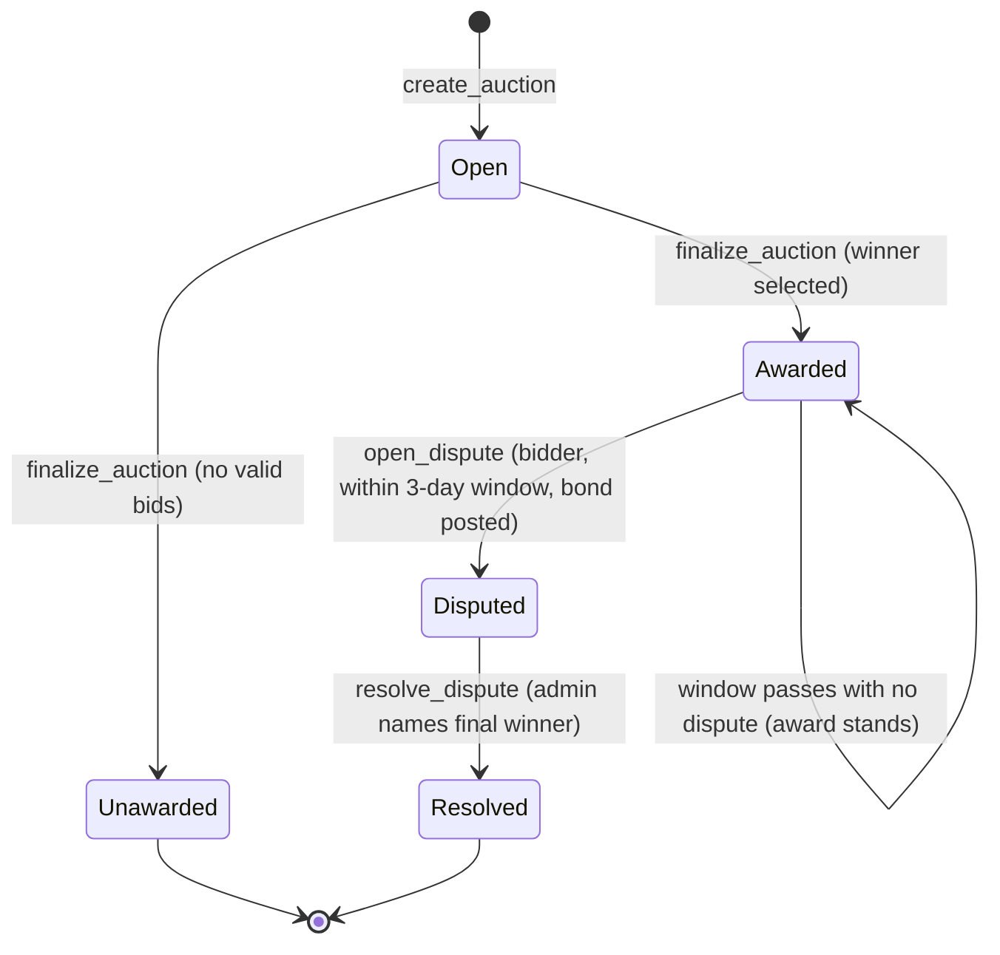

# Marketplace Auctions Design

> **Last updated:** 2026-11-19 · **Doc version:** 0.1.0

This document describes the maintenance marketplace contract
(`contracts/marketplace`): dynamic pricing, sealed-bid commit-reveal auctions,
winner selection, and the dispute process. It reflects the code as implemented.
Where a rule is enforced by a specific error, the error name is given.

Times are ledger timestamps in seconds.

## 1. Dynamic pricing

The admin records market observations with `record_market_state(supply, demand)`.
Supply is the number of available engineers and demand is the number of pending
tasks.

- **Target multiplier.** Imbalance is `(demand - supply) / supply`. With zero
  supply the denominator is treated as 1, so the result saturates at the surge cap
  rather than dividing by zero. The target is
  `1.0x + imbalance * sensitivity_bps`, clamped to
  `[min_multiplier_bps, max_multiplier_bps]`.
- **Step limit.** The multiplier moves toward the target by at most
  `max_step_bps` per update. A single observation cannot produce a large jump.
- **Price.** `price = base_price * multiplier / 10_000`, saturating at `u64::MAX`.
- **Rate limit.** Updates are spaced by at least `min_update_interval_secs`
  (`PriceUpdateTooSoon`).
- **Configuration.** `base_price > 0`, `min_multiplier_bps <= 10_000 <= max_multiplier_bps`,
  `max_step_bps > 0`, and `0 < sensitivity_bps <= 100_000`. Invalid configuration is
  rejected with `InvalidPricingConfig`.
- **History.** Observations are kept in a bounded history, oldest first.

### Elasticity

`get_price_elasticity()` estimates demand elasticity from the last two
observations:

```
elasticity = (%change in demand) / (%change in price)     [bps]
```

A negative value means demand fell as price rose. The result is `Option<i64>`:

- `None` when the estimate is undefined. That covers fewer than two observations,
  prior demand of zero, a prior price of zero, or an unchanged price.
- `Some(0)` only when demand is measured as unresponsive to price.

Callers must treat `None` as "no estimate", not as zero elasticity.

## 2. Auctions

The admin opens an auction with `create_auction`. Each auction is either **open**
or **sealed**.

| Parameter | Rule |
|---|---|
| `bid_end` | Must be in the future at creation (`InvalidAuctionConfig`). |
| `reveal_end` | Required for sealed auctions and must be after `bid_end`. Ignored for open auctions, where it equals `bid_end`. |
| `ceiling_price` | Optional. Defaults to the current dynamic price. Must be non-zero. |
| `criterion` | `LowestPrice` or `HighestReputation`. See section 3. |

Bids are capped at `MAX_BIDS_PER_AUCTION` (100) per auction (`BidLimitReached`).
A bid price must satisfy `0 < price <= ceiling_price` (`InvalidBid`). Each engineer
may bid or commit once per auction (`AlreadyBid`). Every bidder must hold a valid
or grace-period credential from the engineer registry (`NotCredentialed`).

### Timing windows

**Open auction**

```
created ──► bidding open ───────────── bid_end ──► finalizable after reveal_end (= bid_end)
            place_bid allowed while now <= bid_end
```

**Sealed auction**

```
created ──► commit window ──── bid_end ──── reveal window ──── reveal_end ──► finalizable
            commit_bid while now <= bid_end   reveal_bid while bid_end < now <= reveal_end
```

- `finalize_auction` requires `now > reveal_end` (`AuctionStillOpen` otherwise).
- Bidding closes after `bid_end`: `place_bid` and `commit_bid` return `BiddingClosed`.
- Reveals are accepted only inside the reveal window (`RevealWindowClosed`).

### Sealed bids (commit-reveal)

During the commit window a bidder submits a 32-byte commitment:

```
commitment = sha256( auction_id_be64 || xdr(engineer) || price_be64 || salt )
```

Binding the auction id and engineer means a bidder cannot copy another bidder's
commitment and reveal it as their own. During the reveal window the bidder
submits `price` and `salt`. The contract recomputes the commitment and rejects a
mismatch (`RevealMismatch`).

A commitment that is never revealed by `reveal_end` is ignored at finalization.
The bidder forfeits that bid. Only revealed bids take part in winner selection,
and `get_bids` returns only revealed bids for sealed auctions.

### Lifecycle



`finalize_auction` records `finalized_at`, and the dispute window is measured from
that timestamp. An awarded auction that is never disputed keeps its winner.

## 3. Winner selection

`finalize_auction` picks a winner from the bids in placement order:

- **`LowestPrice`.** The lowest price wins. Ties go to the earliest bid.
- **`HighestReputation`.** The highest reputation at bid time wins. Ties go to the
  lower price, then the earliest bid.

Reputation is snapshotted when the bid is placed (open auctions) or revealed
(sealed auctions). The award records `winner` and `winning_price`. If no valid
bids exist, the auction becomes `Unawarded`.

The contract records the award. It does not move funds for the maintenance task.

## 4. Disputes

### Who and when

- Only a bidder on the auction may dispute (`NotABidder`).
- Only an `Awarded` auction may be disputed (`NotAwarded`).
- The dispute must be opened within `DISPUTE_WINDOW_SECS` (3 days) of
  finalization (`DisputeWindowClosed`).

### Dispute bond

Disputes are not free. A dispute requires a refundable bond that the admin
configures with `set_dispute_bond(token, amount)`. The amount must be positive
(`InvalidDisputeBond`).

- Until a bond is configured, disputes are refused (`DisputeBondNotConfigured`).
- `open_dispute` transfers the bond from the disputing bidder into the contract.
  If the transfer fails, for example because the bidder cannot pay it, the dispute
  is not opened.
- The bond is held per auction. Each auction admits one dispute, because the status
  moves to `Disputed`. A bidder cannot stack disputes on the same award.

### Resolution

The admin resolves a disputed auction with `resolve_dispute(final_winner)`. The
named winner must be a bidder on the auction (`NotABidder`).

| Outcome | Condition | Bond |
|---|---|---|
| **Upheld** | `final_winner` differs from the original winner. The award changes. | Refunded to the disputing bidder. |
| **Not upheld** | `final_winner` is the original winner. The award stands. | Forfeited. It stays in the contract. |

The auction moves to `Resolved` and the winner is final. A `Resolved` auction
cannot be disputed again.

### Events

| Topic | Emitted by | Payload |
|---|---|---|
| `AUC_DISP` | `open_dispute` | bidder, reason, timestamp |
| `AUC_BOND` | `resolve_dispute` | disputing bidder, bond amount, upheld flag |
| `AUC_RSLV` | `resolve_dispute` | admin, final winner, winning price |

## 5. Known limitations

- **No bond sweep.** Forfeited bonds remain in the contract. There is no function
  to withdraw them yet. Treasury handling is a follow-up.
- **Single dispute per award.** Once a dispute is opened, no further dispute on that
  auction is possible, even by another bidder. The admin's resolution is final.
- **Admin resolution.** Disputes are settled by the admin, not by an independent
  arbiter.

## 6. Related code and tests

- `contracts/marketplace/src/lib.rs`: entry points and error codes.
- `contracts/marketplace/src/auction.rs`: auction types, commitment hash, winner
  selection, dispute window.
- `contracts/marketplace/src/pricing.rs`: multiplier, step, price, and elasticity
  arithmetic.
- `contracts/marketplace/src/test.rs`: behavior tests for auctions, disputes, and
  pricing.
